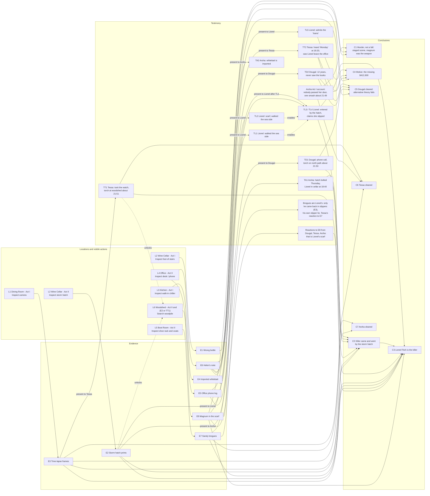

# Last Orders: Clue Graph

Companion to `bible.md`. Solid arrows mean "yields" or "supports". Dotted arrows mean "unlocks" or "enables". Act I accounts are given on the first interview, so they need no trigger.

## Independent paths for each conclusion

Two paths count as independent when they share no evidence card and no testimony transition. Act I accounts are always available.

| Conclusion | Path 1 | Path 2 | Further path(s) |
|---|---|---|---|
| **C1** Murder; the fall was staged; the magnum was the weapon | **E1**: Helen went for the magnum, the magnum is gone, and a cooking bottle was smashed beside her. The injury is at the back of her head although she fell forward. | **E8**: the magnum, hidden in a woodpile, with a smear and grey hairs on its base. | Aroha's Act I account: one smash at about 21:49, nine minutes after Helen went down, with no thump. |
| **C2** The killer came and went by the storm hatch | **E2**: bolt drawn from inside; wet ironsand prints from the hatch to the stairs and back. | **TT1 + TD1**: two separate sightings, during the death window, of a torch at the woodshed beside the hatch (about 21:51) and then on the north path heading for the front (about 21:53). | **TA1**: the bolt was drawn at 18:40. **TL3/TL4**: Lionel admits it. Aroha's account and E3 rule out the dining-room end of the corridor only; the hall passage stays open until E2. |
| **C3** Lionel Fitch is the killer | **Weapon path: E8 + scarf identification.** The weapon was wrapped in Lionel's red tartan scarf. The scarf is identified by the reactions of Dougal, Tessa and Aroha to E8, or by E3 (on him at 21:42, gone at 21:57). | **Route path: E2 + E7 + brogue identification.** The hatch prints have a crescent nick in the left heel. The sandy brogues have the same nick; the car park is gravel. The brogues are identified as Lionel's by Tessa's reaction to E7 or by Lionel's own slipper lie ("I changed in the boot room"), or by E3 (only he came back in slippers). | **Admission: TL3/TL4.** **Motive: C4.** |
| **C4** Motive: the missing $412,600 | **E6 + TD2**: the note says the money went through the books over 15 years and the culprit has known Helen 40 years; Dougal says he has known her 12 years and Lionel keeps the books (Lionel says so himself in his Act I account). | **TT2**: Tessa heard "Monday. Not a day later." at 18:20 while Dougal was in the lounge, then saw Lionel leave the office. | **TL5**: Lionel admits the "loans". |
| **C5** Dougal is cleared (the alternative theory fails) | **E5 + E3**: the corded office phone was in use 21:46–21:55; only Dougal and Lionel were away for the whole call, and Lionel was outside (E7). TD1 confirms it was Dougal. | **TD2 + TT2**: the note's "forty years" does not fit him (twelve years), he never saw the books, and he was in the lounge when Helen said "Monday" to Lionel. | **E2 + E7**: the nicked heel is on Lionel's sandy brogues, not Dougal's dry shoes. Aroha's smash at about 21:49 falls inside his call. |
| **C6** Tessa is cleared | **Weak: E3 + Aroha's Act I account.** Tessa was at the table until 21:50, and the smash came at about 21:49. This rests on a one-minute gap and Aroha's estimate of the time. | **E3**: at 21:50 she starts up the main stairs and at 21:58 she comes back down them; the cellar is downstairs, and the stairs are the only way up. | **TT1**: she was upstairs in Helen's room, watching the torch at the woodshed. |
| **C7** Aroha is cleared | **E3**: she is at the kitchen bench from 21:41 to 21:59 and never out of shot for more than 20 seconds. | **E2 + E7**: the prints are a men's size 11 leather brogue with a nicked heel, and that brogue is Lionel's. | None needed. E4 / TA2 explain why she lied about the whitebait. |

The two decisive paths for C3 share no card when the identifications come from testimony: the weapon path uses E8 and the reactions to it; the route path uses E2, E7 and Tessa's reaction to E7 or Lionel's slipper lie. E3 can identify both the scarf and the shoes, but neither path needs it. Either path alone names Lionel and places him at the scene with the method.
